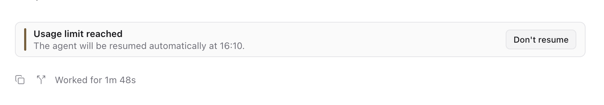
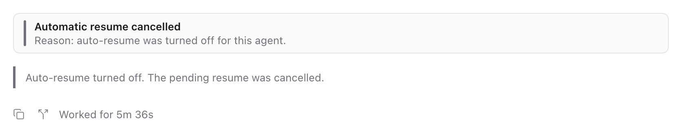

# Usage resume for Paseo

A [Paseo](https://paseo.sh) plugin that continues your agents on their own after a provider
usage limit stops them.

When a turn ends on a usage-limit message, the plugin reads the account's quota, waits until
the depleted window resets, and sends the agent a short prompt to continue where it stopped.
A status row in the conversation shows the limit that was hit and when the agent will be resumed.



## Install

Requires Paseo 0.15.4 or later, with plugins enabled (Settings → Plugins).

```bash
paseo plugin install github:vquelque/paseo-usage-resume
```

Update later with `paseo plugin update usage-resume`.

## Turn it off for one agent

Auto-resume is on for every top-level agent by default. To opt a chat out:

- Press **Don't resume** on the status row while a resume is pending.
- Run `/autoresume off` in the agent's composer (`on` re-enables it, no argument toggles it).
- Open ⌘K and pick **Turn off auto-resume for this agent**.



## Good to know

- Only top-level agents are resumed; sub-agents are left to their parent.
- An agent is resumed at most 4 times in a row.
- Prompting, cancelling, or archiving the agent cancels a pending resume.
- Pending resumes survive a daemon restart (`~/.paseo/usage-resume/state.json`).

See [OVERVIEW.md](OVERVIEW.md) for the full details of how it decides when to resume.
